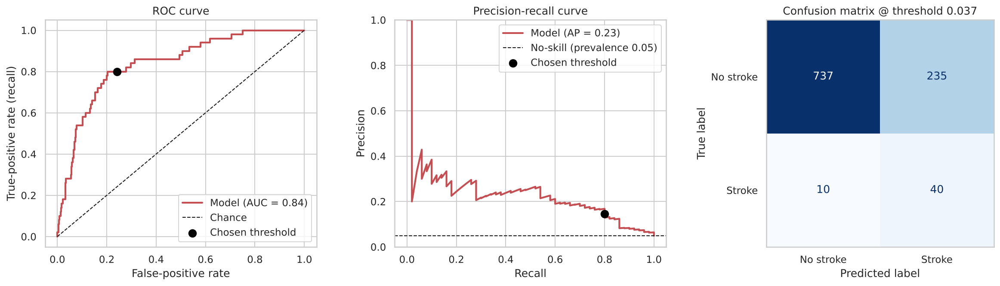
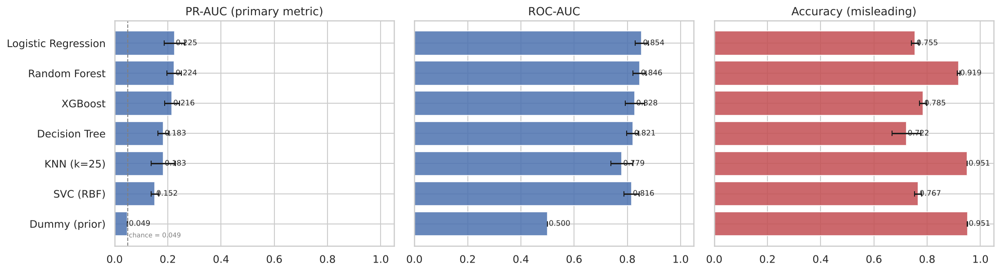
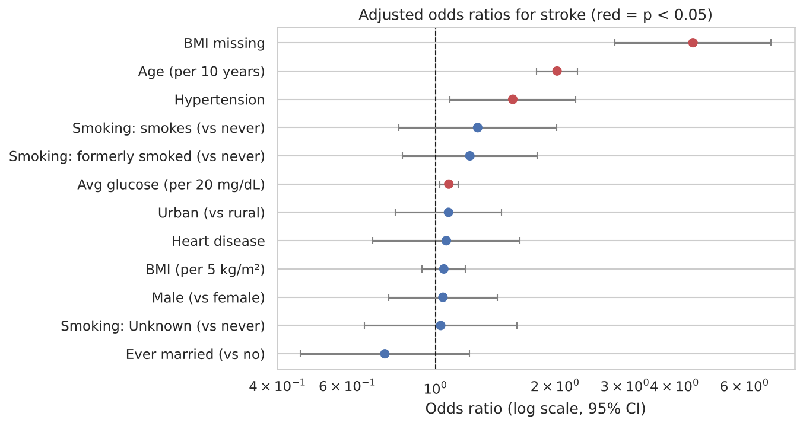

# Stroke Risk Prediction on Imbalanced Clinical Data

[](https://colab.research.google.com/github/YOUR-USERNAME/stroke-prediction/blob/main/notebooks/stroke_prediction.ipynb)


A reproducible machine-learning pipeline that estimates stroke risk from routine clinical and demographic variables, with an emphasis on **honest evaluation of a rare-event problem** (only ~5% of patients had a stroke).

> **Headline result (held-out test set, 1,022 patients / 50 strokes):** ROC-AUC **0.84** (95% CI 0.78-0.89), PR-AUC **0.24** vs. 0.05 for chance. At a threshold fixed beforehand for 80% recall, the model catches 40 of 50 strokes with a 98.7% negative predictive value, at the cost of 14.5% precision. A paired bootstrap shows that **age alone is statistically indistinguishable from the full model**: most of the signal is age.

## Why this project is not "just another accuracy score"

On this dataset, a model that predicts *no stroke* for everyone is **95% accurate and detects nothing**. The project is designed around avoiding that trap:

| Problem | How it is handled |
|---|---|
| Accuracy is misleading at 5% prevalence | Models compared on **PR-AUC**, ROC-AUC, recall, precision; a dummy baseline is included |
| Data leakage | Imputation, scaling and encoding live inside a scikit-learn `Pipeline`, fitted on training folds only; the test set is used once |
| Missing BMI (3.9%) | Not dropped. Missing-BMI patients have a **~4.6x higher stroke rate**, so missingness is kept as a feature; dropping them would lose 16% of all positives |
| Nominal variables | One-hot encoded (no fake ordering) |
| Class imbalance | Class weights vs. SMOTE (inside the CV pipeline) compared; neither improves PR-AUC, so the pipeline relies on a tuned threshold instead |
| Threshold | Chosen on **out-of-fold training predictions** for 80% recall, then evaluated once on the test set |
| Calibration | Sigmoid calibration + calibration curve and Brier score |
| Uncertainty | 1,000-sample bootstrap 95% CIs for every headline metric |
| Interpretability | Adjusted odds ratios (statsmodels logit) and permutation importance |
| "Is the fancy model worth it?" | Compared against an age-only logistic regression with a paired bootstrap |

## Results

<p align="center"></p>

| Metric (test set) | Estimate | 95% CI |
|---|---|---|
| ROC-AUC | 0.84 | 0.78 - 0.89 |
| PR-AUC (chance = 0.05) | 0.24 | 0.15 - 0.35 |
| Recall @ threshold | 0.80 | 0.69 - 0.91 |
| Specificity | 0.76 | 0.73 - 0.79 |
| Precision (PPV) | 0.145 | 0.10 - 0.19 |
| NPV | 0.987 | 0.98 - 0.995 |

**Model comparison** (5-fold stratified CV on the training set):

<p align="center"></p>

After correct preprocessing, a plain logistic regression is on par with random forest and XGBoost. The same models ranked by accuracy are the *opposite* of the ranking by PR-AUC, which is the point of the right-hand panel.

**Key findings**
- **Age** dominates (adjusted OR ~2.0 per decade, 95% CI 1.8-2.3). Hypertension (OR ~1.6) and average glucose (OR ~1.08 per 20 mg/dL) add modest independent risk.
- Heart disease and smoking look strong in raw rates but largely **disappear after adjusting for age**.
- Missing BMI is a strong marker (OR ~4.5), a data-collection artefact rather than biology.

<p align="center"></p>

## Limitations

- Only 249 positive cases: wide confidence intervals, split-dependent numbers.
- Single public Kaggle dataset of unverified provenance; no external validation.
- Observational associations, not causal effects. Strong confounding by age.
- Informative missingness suggests the data-collection process is entangled with outcome.
- The 80%-recall operating point stands in for a real clinical cost trade-off.

**This is an educational project, not a medical device.**

## Repository structure

```
stroke-prediction/
├── README.md
├── requirements.txt
├── app.py                     # Streamlit demo using the saved model
├── data/
│   └── healthcare-dataset-stroke-data.csv
├── notebooks/
│   └── stroke_prediction.ipynb   # full analysis, executed with outputs
├── models/
│   ├── stroke_model.joblib       # calibrated model
│   └── model_card.json           # threshold, test metrics, versions
└── images/                       # figures used in the README
```

## Reproduce

```bash
git clone https://github.com/YOUR-USERNAME/stroke-prediction.git
cd stroke-prediction
python -m venv .venv && source .venv/bin/activate    # Windows: .venv\Scripts\activate
pip install -r requirements.txt

jupyter lab notebooks/stroke_prediction.ipynb        # Run All (~3-4 min on 1 CPU core)
streamlit run app.py                                  # interactive demo
```

All random seeds are fixed (`SEED = 42`), so results are reproducible. The saved model was trained with the library versions pinned in `requirements.txt`; loading it with a different scikit-learn version may raise a warning, in which case re-run the notebook to regenerate it.

## Data

[Stroke Prediction Dataset](https://www.kaggle.com/datasets/fedesoriano/stroke-prediction-dataset) (Kaggle, fedesoriano). 5,110 patients, 11 features. Please check the dataset's licence on Kaggle before redistributing; if in doubt, remove the CSV from `data/` and ask users to download it.

## Tech stack

Python · pandas · scikit-learn · imbalanced-learn · XGBoost · statsmodels · matplotlib / seaborn · Streamlit
